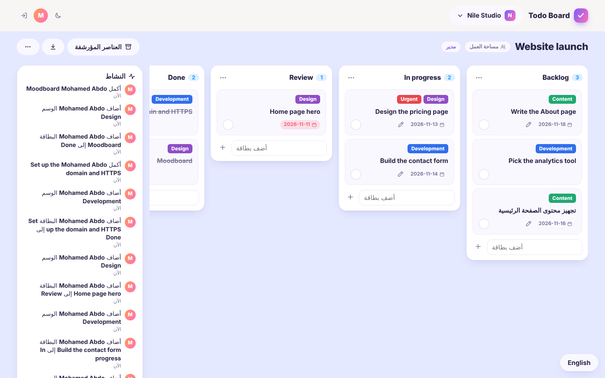
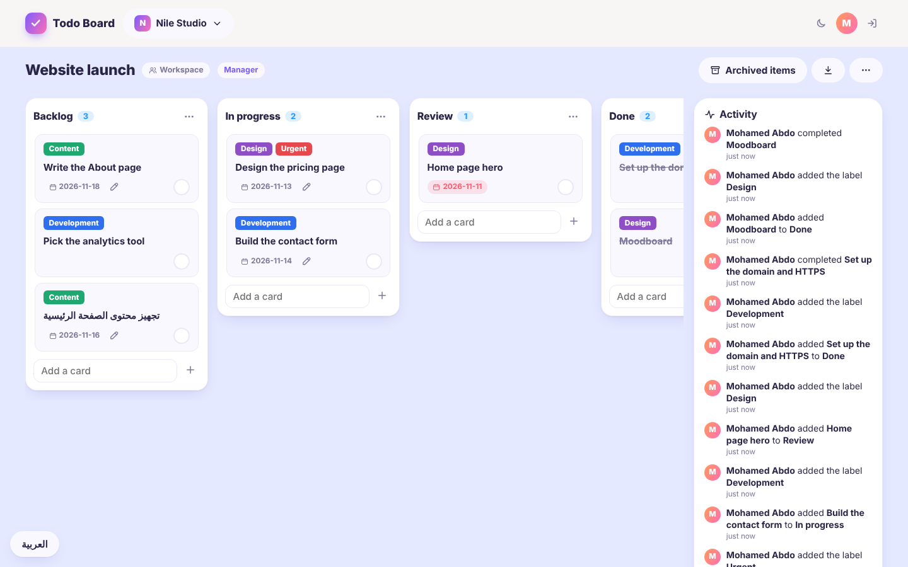
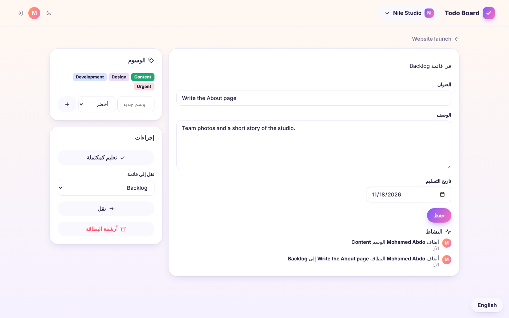
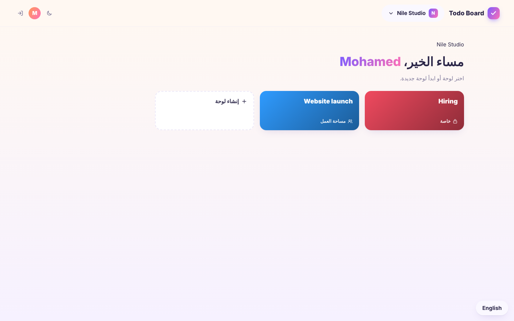

<div align="center">


# Todo Board

**A team board for companies, built with plain PHP, PDO and vanilla JavaScript.**
Companies, shared boards, lists and cards, with Arabic (right to left) as the default language and English one click away.
No framework, no Composer, no build step.




</div>

---

## Table of contents

- [Features](#features)
- [Screenshots](#screenshots)
- [Getting started](#getting-started)
- [Project structure](#project-structure)
- [Modules](#modules)
- [How it works](#how-it-works)
- [Routes](#routes)
- [Languages](#languages)
- [Tests](#tests)
- [Security](#security)
- [Performance](#performance)
- [Roadmap](#roadmap)
- [Author](#author)

---

## Features

**Companies and teams**
- 🏢 **Companies with their own workspace.** Every account gets a personal workspace, and you can create as many companies as you need.
- 🔀 **Workspace switcher** in the header. The next sign-in opens the workspace you were last in.
- 👥 **Roles.** Workspace roles are owner, admin, member and guest. Board roles are manager, member and viewer.
- 🔒 **Private or workspace boards.** A private board is visible only to its members. A workspace board can be seen by every full member of the workspace.

**Boards**
- 🗂️ **Boards, lists and cards**, in any number of lists you like.
- 🖱️ **Drag and drop** for cards (inside a list or across lists) and for whole lists. This also works right to left.
- 🏷️ **Labels** in nine colors, set per board.
- 📅 **Start and due dates** with overdue highlighting, and a done checkbox on every card.
- 🙋 **Assignees.** Put people from the board on a card and see their faces on the tile.
- 📝 **Markdown descriptions**, rendered safely (no raw HTML, only http, https and mailto links).
- ☑️ **Checklists** on a card, with progress on the board tile. Items can be dragged within and between checklists.
- 💬 **Comments with @mentions** and **votes**. Each board decides who may comment and vote: no one, members only, or everyone who can see it.
- 🔎 **Filters and search.** Filter a board by text, label, person, due date or status, and search cards across every board you can see.
- 🗄️ **Archive, then delete.** Archived lists, cards and boards can be restored. Deleting a card is only possible once it is archived.
- 📜 **Activity feed** for each board and each card, with a full page you can scroll back through.
- ⬇️ **CSV export** of a board. It opens cleanly in Excel and is safe against formula injection.

**Everyday comfort**
- 🌍 **Arabic by default (RTL), English ready.** Mixed Arabic and English text lines up correctly.
- 🌙 **Dark mode** that follows your system and remembers your choice.
- 📱 **Responsive** down to phone width.
- ⌨️ **Keyboard shortcuts**: `/` search, `f` filters, `n` new card, `e` edit card, `c` comment, `?` list them all.
- 📦 **Old tasks come along.** Tasks from the single-board version are moved to "My Board" automatically on first sign-in.

## Screenshots

| Arabic (default) | English |
|---|---|
|  |  |

| Dark | A card |
|---|---|
|  |  |

| Sign in | Boards of a company |
|---|---|
|  |  |

<p align="center">
  
</p>

## Getting started

### Requirements
- PHP **8.1+** with `pdo_sqlite` (default) or `pdo_mysql`, and `mbstring`
- That's it. No Composer, no npm, no framework.

### Option 1: zero setup (SQLite)

```bash
git clone https://github.com/m77mdabdo/TO_DO_LIST.git
cd TO_DO_LIST
php -S localhost:8000 index.php
```

Open <http://localhost:8000> and create an account.
The database file is created automatically in `database/todo.sqlite`.

Want a demo company to click around in?

```bash
php database/seed.php
```

| Login | Password | What you see |
|---|---|---|
| `demo@todo.test` | `demo1234` | Owner of "Nile Studio": a shared "Website launch" board and a private "Hiring" board. Some old-style tasks are also imported into "My Board" on the first sign-in. |
| `mona@todo.test` | `demo1234` | A member of "Nile Studio". She sees the shared board but not the private one. |

### Option 2: XAMPP + MySQL

1. Copy the project into `htdocs/TO_DO_LIST`.
2. Create a database called `to_do_list` in phpMyAdmin.
3. Copy `config.php` to `config.local.php` and set:
   ```php
   'driver' => 'mysql',
   'name'   => 'to_do_list',
   'user'   => 'root',
   'pass'   => '',
   ```
4. Make sure `mod_rewrite` is on (it is by default in XAMPP), then visit <http://localhost/TO_DO_LIST>.
   Tables are created on the first request. You can also run `php database/migrate.php`.
   On a real server, set `APP_AUTO_MIGRATE=false` and migrate on deploy.

You can also use environment variables instead of `config.local.php`:
`DB_DRIVER`, `DB_HOST`, `DB_PORT`, `DB_NAME`, `DB_USER`, `DB_PASS`, `APP_NAME`, `APP_TIMEZONE`, `APP_LOCALE`.

### Command line

```bash
php database/migrate.php            # run pending migrations
php database/migrate.php --pending  # list them without running
php database/seed.php               # demo company (fresh database only)
php database/import-legacy.php      # move every user's old tasks to boards now, instead of on sign-in
```

## Project structure

```
TO_DO_LIST/
├── index.php               # front controller: every request comes in here
├── config.php              # default settings (override with config.local.php or env vars)
├── bootstrap/
│   ├── autoload.php        # App\ → src/ autoloader (no Composer needed)
│   ├── app.php             # wires the shared services together in the container
│   └── modules.php         # the enabled modules, in boot order
├── routes/web.php          # app-wide routes (language switch); modules add their own
├── lang/ar.php             # Arabic catalog (English text is the key)
│
├── src/
│   ├── Core/               # Container (dependency injection) and Config
│   ├── Http/               # Request, Response, Router, Kernel, Url, middleware
│   ├── Modules/            # feature modules (see "Modules" below)
│   ├── Shared/             # Events (EventBus), Module (ModuleProvider), Ids (ULID), Ordering (FractionalIndex)
│   ├── I18n/               # Translator
│   ├── Validation/         # Validator, Rule interface and one class per rule
│   ├── Session/            # Session interface, NativeSession, ArraySession (tests)
│   ├── Security/Csrf.php
│   ├── View/               # View renderer with composers, FormState, Icons
│   ├── Database/           # ConnectionFactory, Transactions, OrderedRows, Migrations/
│   └── Support/            # Clock, TimeAgo, Greeting, Logger
│
├── views/                  # plain PHP templates: layout, boards/*, cards/*, workspaces/*, auth/*, partials/*
├── assets/                 # style.css (light + dark, logical properties for RTL), app.js, theme.js
├── database/               # migrations/, migrate.php, seed.php, import-legacy.php
├── storage/logs/           # error logs
└── tests/                  # Unit, Integration, Feature and Architecture tests + a tiny runner
```

## Modules

The app is a modular monolith. Each feature lives in `src/Modules/<Name>/` with the same layers:

| Layer | Holds | May depend on |
| --- | --- | --- |
| `Contract/` | interfaces, read models and events other modules may use | `Shared` only |
| `Domain/` | entities, value objects, repository interfaces, rules | `Contract`, `Shared` |
| `Application/` | use cases that coordinate the domain | `Domain`, `Contract`, `Shared` |
| `Infrastructure/` | PDO repositories, migrations | anything in the module |
| `Http/` | controllers | anything in the module |

| Module | Owns |
| --- | --- |
| **Identity** | accounts, sign in, password hashing (Argon2id), login throttling |
| **Workspace** | companies, their workspace, members and roles, the current workspace |
| **Access** | board members and roles, and the gate that answers "may this user do this on this board?" |
| **Board** | boards and their lists, ordering, archiving, CSV export |
| **Card** | cards: create, edit, complete, move, archive, delete |
| **Label** | board labels and which cards carry them |
| **Checklist** | checklists and their items on a card, progress per card |
| **Discussion** | comments, @mentions and votes on cards |
| **Activity** | the activity feed, built only from other modules' events |
| **LegacyImport** | moves tasks from the single-board version into boards |

A module talks to another one in exactly two ways: by calling its `Contract\` interfaces, or by
listening to the domain events it publishes on the `EventBus`. `tests/Architecture/ModuleBoundaryTest.php`
fails the build if any code reaches past that.

Each module has a `<Name>Module` provider (listed in `bootstrap/modules.php`) that binds its services,
adds its routes, subscribes its listeners and points to its migrations folder.
Migrations are plain SQL files named `<timestamp>_<what>.<sqlite|mysql>.sql`. Each runs once and
is recorded in `schema_migrations`.

## How it works

```
Request ─▶ index.php ─▶ Kernel
                         ├─ SecurityHeaders, VerifyCsrfToken          (every request)
                         ├─ Router: POST /cards/{card:ulid}/move ─▶ route
                         ├─ Authenticate                              (route middleware)
                         └─ CardController::move()
                               └─ CardService ─▶ AccessGate (Access contract): may this user move cards?
                                              ─▶ CardRepository ─▶ PdoCardRepository (SQLite / MySQL)
                                              ─▶ EventBus: CardMoved ─▶ Activity records it
Response ◀─ redirect, HTML from views/, or JSON for drag and drop
```

**Ordering.** Lists and cards are ordered by a text key (fractional indexing). Dropping a card
"after X" computes one new key between X and its neighbour and updates one row, however long the
list is. When keys grow too long, that one list is re-spaced.

**Public ids.** Boards, cards and workspaces appear in URLs as ULIDs, never as numeric ids.

**Permissions.** A board role is a bitmask of permissions. The gate checks, in order: the user's
own board role, then workspace owner or admin (treated as manager), then a workspace board that
full members may view. Anyone else gets a 404, so private boards don't reveal that they exist.
Archived boards are read-only.

## Routes

| Method | URL | Action |
|---|---|---|
| GET | `/` | boards of the current workspace |
| GET / POST | `/login`, `/register` | sign in, create an account |
| POST | `/logout` | sign out |
| POST | `/locale/{ar\|en}` | switch language |
| GET / POST | `/workspaces/new`, `/workspaces` | create a company |
| POST | `/workspaces/{id}/switch` | switch workspace |
| GET | `/workspaces/{id}/members` | workspace members |
| POST | `/boards` | create a board |
| GET / POST | `/boards/{id}` | show / update a board |
| POST | `/boards/{id}/archive`, `/restore` | archive or restore a board |
| GET | `/boards/{id}/archived` | archived lists and cards |
| GET | `/boards/{id}/export` | download the board as CSV |
| POST | `/boards/{id}/lists` | add a list |
| POST | `/boards/{id}/lists/{list}` (`/move`, `/archive`, `/restore`) | rename, move, archive, restore a list |
| POST | `/boards/{id}/cards` | add a card |
| POST | `/boards/{id}/labels` | add a label |
| GET / POST | `/cards/{id}` | show / update a card |
| POST | `/cards/{id}/complete`, `/move`, `/archive`, `/restore`, `/delete` | card actions (forms or `fetch()`) |
| POST | `/cards/{id}/labels/{label}` | toggle a label on a card |
| POST | `/cards/{id}/members` | add or remove a person on a card |
| POST | `/cards/{id}/checklists` | add a checklist |
| POST | `/checklists/{id}` (`/delete`, `/items`) | rename or delete a checklist, add an item |
| POST | `/checklist-items/{id}` (`/toggle`, `/move`, `/delete`) | edit, tick, move or delete an item |
| POST | `/cards/{id}/comments`, `/cards/{id}/vote` | comment on a card, vote for it |
| POST | `/comments/{id}`, `/comments/{id}/delete` | edit or delete a comment |
| GET | `/boards/{id}/activity` | the board's whole activity, page by page |
| GET | `/search?q=` | search cards in the current workspace |

Every state change is a POST route with a CSRF token. Other methods get 405.

## Languages

Arabic is the default and is rendered right to left. English is one click away from the switch in
the corner. The choice is kept in the session, and the default comes from the `locale` setting
(`APP_LOCALE`).

Text in templates is written in English and passed through `$this->t()` / `$this->te()`. The Arabic
translations live in `lang/ar.php`. To add a language, add `lang/<code>.php` and its direction to
`App\I18n\Translator::SUPPORTED`. `TranslationsTest` fails if a template string has no Arabic
translation.

The stylesheet uses logical properties (`margin-inline-start`, `inset-inline-end`, …), so the
same CSS works in both directions. User text carries `dir="auto"` and names inside sentences are
isolated with `<bdi>`, so an English card title in an Arabic sentence (or the other way round)
stays in the right place.

## Tests

```bash
php tests/run.php            # everything
php tests/run.php Board      # only tests whose name contains "Board"
```

No PHPUnit needed: `tests/TestCase.php` is a small base class. Unit tests cover the domain classes,
integration tests run the repositories against an in-memory SQLite database, feature tests send real
requests through the whole app (routing, middleware, CSRF, permissions, controllers and views), and
architecture tests check the module boundaries and translations. The suite runs on GitHub Actions
for PHP 8.1 and 8.3, together with PHPStan.

## Security

| Threat | How it's handled |
|---|---|
| SQL injection | PDO prepared statements everywhere, emulated prepares off; updates go through an allow-list of columns |
| XSS | Output escaped in every template; strict **Content-Security-Policy** (no inline scripts or styles) |
| CSRF | Per-session token on every form and `fetch()` call, compared with `hash_equals` |
| State changes over GET | Every change is a POST route; other methods get 405 |
| Seeing another company's data (IDOR) | Every board, card and workspace action goes through the access gate; unknown or hidden ids return 404 |
| Guessable URLs | Public ids are ULIDs, not sequential numbers |
| Passwords | Argon2id, automatic rehash, same timing for unknown emails |
| Brute force | 5 failed logins per IP → 15-minute lock |
| Session fixation / theft | ID regenerated on login, strict mode, `HttpOnly` + `SameSite=Lax` (+ `Secure` on HTTPS) |
| Clickjacking & sniffing | `X-Frame-Options: DENY`, `frame-ancestors 'none'`, `nosniff`, `Referrer-Policy` |
| CSV formula injection | Cells starting with `=`, `+`, `-`, `@` are neutralised in exports |
| Open redirects | The language switch only returns to a path on this site |
| Direct file access | Everything goes through `index.php`; `.htaccess` blocks `src/`, `views/`, `database/`, `storage/`, `lang/`, `bootstrap/`, `routes/`, `tests/` and config files |

## Performance

- **No N+1 queries.** A board page loads its lists, all their open cards, the labels of those cards and the people in the feed with one query each.
- **Cheap reordering.** A drag and drop writes one row (fractional ordering), not the whole list.
- **Indexes for every hot path**: cards by `(list_id, position)`, activity by `(board_id, id)`, memberships by `(user_id, …)`.
- **Keyset pagination** for the activity feed, so older pages cost the same as the first.
- **Hash-map routing.** Static routes are looked up directly and dynamic ones are bucketed by their first segment.
- **Per-request caches** for permission checks and roles, so a page that asks the same question many times hits the database once.
- **No CSS/JS frameworks**, system fonts and inline SVG icons. Assets get a `?v=` cache-busting version.
- SQLite runs in WAL mode.

## Roadmap

- [x] Companies, workspaces and roles
- [x] Boards, lists, cards, labels and activity
- [x] Arabic interface (RTL) with English
- [x] Export a board as CSV
- [ ] Invitations by email and member management
- [x] Checklists, comments, mentions and votes on cards
- [x] Search and filters
- [ ] Attachments on cards
- [ ] Notifications and due-date reminders
- [ ] Import from CSV

Ideas and pull requests are welcome.

## Author

**Mohamed Abdo**, Full Stack Developer (PHP / Laravel)

- GitHub: [@m77mdabdo](https://github.com/m77mdabdo)

If this project helped you, consider giving it a ⭐
