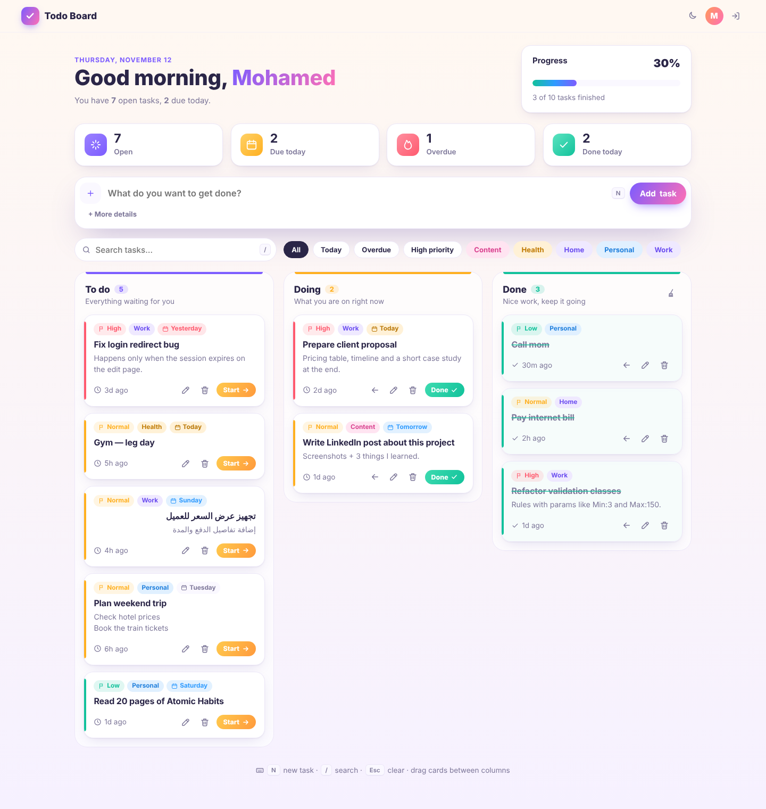
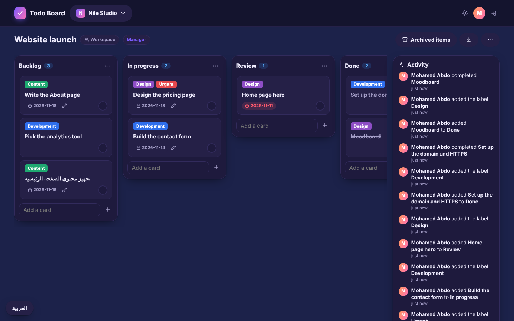
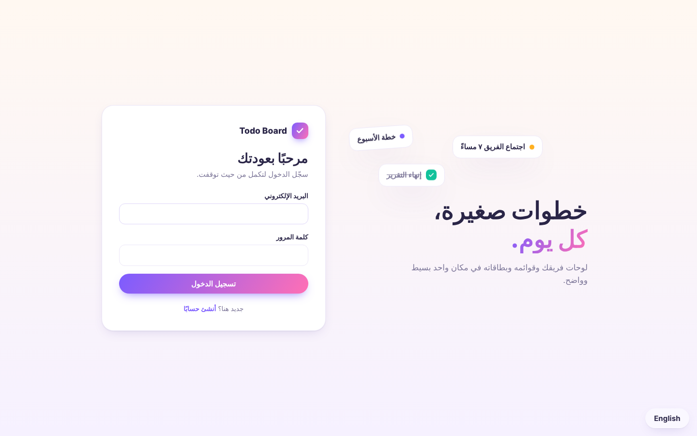
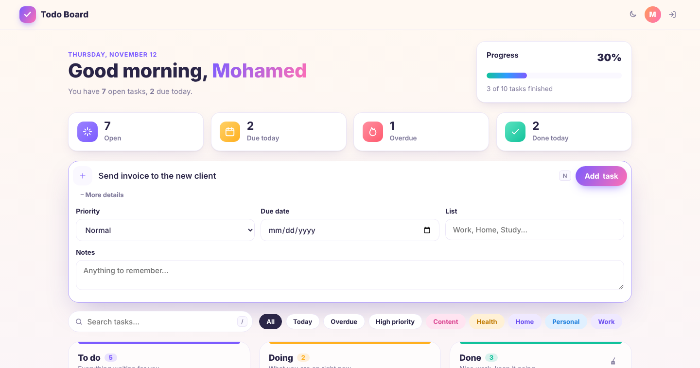
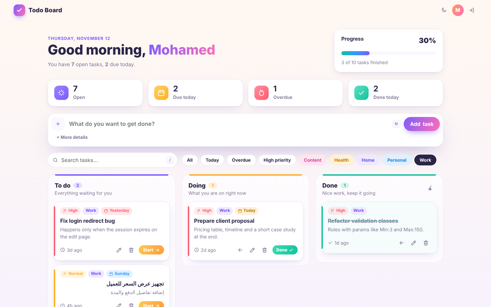
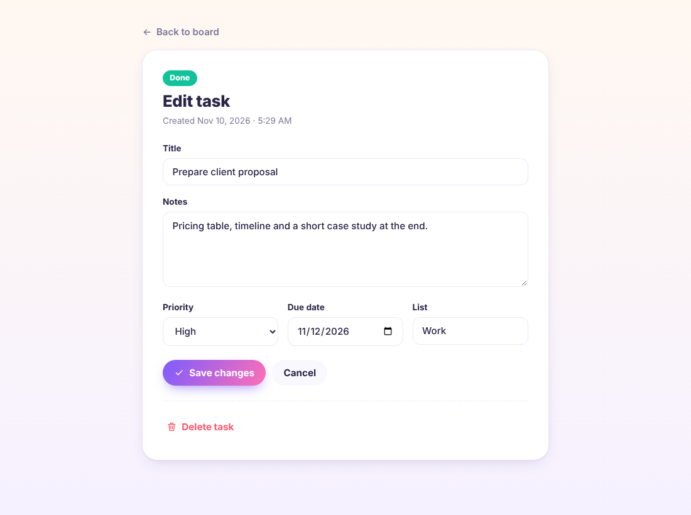
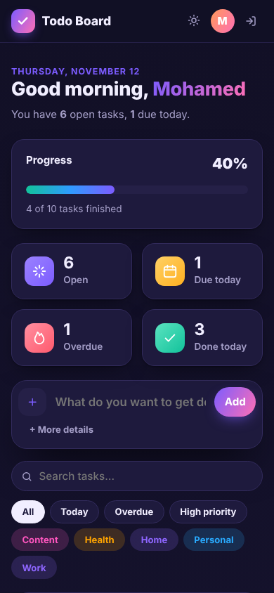
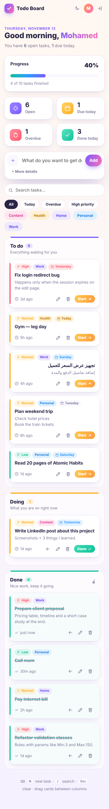

<div align="center">


# Todo Board

**A bright, fast and secure task board built with plain PHP, PDO and vanilla JavaScript.**
No framework, no build step, no heavy CSS library — just clean OOP you can read in one sitting.




</div>

---

## Table of contents

- [Why I built it](#why-i-built-it)
- [Features](#features)
- [Screenshots](#screenshots)
- [Getting started](#getting-started)
- [Project structure](#project-structure)
- [How it works](#how-it-works)
- [Security](#security)
- [Performance](#performance)
- [Adding your own features](#adding-your-own-features)
- [Roadmap](#roadmap)
- [Author](#author)

---

## Why I built it

This started as a small CRUD exercise (add / edit / delete notes with three statuses) to practice OOP,
SOLID and PDO in native PHP. I rebuilt it into something I actually use every day: a personal board
for work, study and life tasks — while keeping the same simple structure of `classes/`, `handle/` and `inc/`
so it stays easy to learn from and easy to extend.

## Features

**Everyday use**
- 🗂️ **Kanban board** — *To do*, *Doing* and *Done* columns
- ⚡ **Quick add** — type a title and hit Enter; open *More details* for priority, due date, list and notes
- 🚩 **Priorities** — High / Normal / Low, color coded and sorted automatically
- 📅 **Due dates** — friendly labels (*Today*, *Tomorrow*, *Sunday*, *2 days late*) with overdue highlighting
- 🏷️ **Lists / categories** — each list gets its own color, with autocomplete from your existing lists
- 🔍 **Instant search & filters** — Today, Overdue, High priority, or any list — no page reload
- 🖱️ **Drag & drop** cards between columns (buttons still work without JavaScript)
- 📊 **Progress & stats** — open, due today, overdue, done today and a completion bar
- 🎉 **A small celebration** when you finish a task
- 🌙 **Dark mode** — follows your system and remembers your choice
- ⌨️ **Keyboard shortcuts** — <kbd>N</kbd> new task, <kbd>/</kbd> search, <kbd>Esc</kbd> clear
- 📱 **Responsive** — works nicely on phones
- 🌍 **Arabic & English text** — every task field uses `dir="auto"`, so RTL text just works

- ⬇️ **Export** — download all your tasks as a CSV that opens in Excel or Google Sheets

**Accounts**
- 👤 Register / log in / log out — every user has a private board
- 🧹 Clear all finished tasks in one click

## Screenshots

| Light | Dark |
|---|---|
|  |  |

| Log in | Quick add with details |
|---|---|
|  |  |

| Filter by list | Edit a task |
|---|---|
|  |  |

<p align="center">
  
  &nbsp;&nbsp;
  
</p>

## Getting started

### Requirements
- PHP **8.1+** with `pdo_sqlite` (default) or `pdo_mysql`, and `mbstring`
- That's it — no Composer, no npm, no framework

### Option 1 — Zero setup (SQLite)

```bash
git clone https://github.com/m77mdabdo/TO_DO_LIST.git
cd TO_DO_LIST
php -S localhost:8000 index.php
```

Open <http://localhost:8000>, create an account and start adding tasks.
The database file is created automatically in `database/todo.sqlite`.

Want sample data to play with?

```bash
php database/seed.php
# then log in with: demo@todo.test / demo1234
```

### Option 2 — XAMPP + MySQL

1. Copy the project into `htdocs/TO_DO_LIST`.
2. Create a database called `to_do_list` in phpMyAdmin.
3. Copy `config.php` to `config.local.php` and set:
   ```php
   'driver' => 'mysql',
   'name'   => 'to_do_list',
   'user'   => 'root',
   'pass'   => '',
   ```
4. Make sure `mod_rewrite` is on (it is by default in XAMPP), then visit <http://localhost/TO_DO_LIST>.
   Tables are created on the first request
   (or import `database/schema.mysql.sql` yourself).

You can also use environment variables instead of `config.local.php`:
`DB_DRIVER`, `DB_HOST`, `DB_PORT`, `DB_NAME`, `DB_USER`, `DB_PASS`, `APP_NAME`, `APP_TIMEZONE`.

## Project structure

```
TO_DO_LIST/
├── index.php               # front controller — every request comes in here
├── config.php              # default settings (override with config.local.php or env vars)
├── bootstrap/
│   ├── autoload.php        # App\ → src/ autoloader (no Composer needed)
│   └── app.php             # wires every service together in the container
├── routes/web.php          # the list of URLs and which controller handles them
│
├── src/
│   ├── Core/               # Container (dependency injection) and Config
│   ├── Http/               # Request, Response, Router, Kernel, Url
│   │   └── Middleware/     # VerifyCsrfToken, Authenticate, RedirectIfAuthenticated, SecurityHeaders
│   ├── Controllers/        # Board, Task, Login, Register — thin, no SQL, no HTML
│   ├── Task/               # Task, Status, Priority, DueDate, Board, BoardStats,
│   │                       # TaskService, TaskRepository (interface) + PdoTaskRepository
│   ├── Auth/               # User, AuthService, UserRepository + PDO version,
│   │                       # LoginThrottle + PDO version, PasswordHasher
│   ├── Validation/         # Validator, Rule interface and one class per rule
│   ├── Session/            # Session interface, NativeSession, ArraySession (tests)
│   ├── Security/Csrf.php
│   ├── View/               # View renderer, FormState (errors + old input), Icons
│   ├── Database/           # ConnectionFactory, Migrator
│   └── Support/            # Clock, TimeAgo, Greeting, Logger
│
├── views/                  # plain PHP templates: layout, board, tasks/edit, auth/*, partials/*
├── assets/                 # style.css (~20 KB, light + dark), app.js, theme.js, favicon
├── database/               # schema.sqlite.sql, schema.mysql.sql, seed.php
├── storage/logs/           # error logs
└── tests/                  # Unit, Integration and Feature tests + a tiny runner
```

## How it works

```
Request ─▶ index.php ─▶ Kernel
                         ├─ SecurityHeaders, VerifyCsrfToken      (every request)
                         ├─ Router: POST /tasks/{id}/move ─▶ route
                         ├─ Authenticate                          (route middleware)
                         └─ TaskController::move()
                               └─ TaskService ─▶ TaskRepository (interface)
                                                    └─ PdoTaskRepository (SQLite / MySQL)
Response ◀─ redirect, HTML from views/, or JSON for drag & drop
```

### Routes

| Method | URL | Action |
|---|---|---|
| GET | `/` | the board |
| GET / POST | `/login`, `/register` | sign in, create an account |
| POST | `/logout` | sign out |
| POST | `/tasks` | add a task |
| GET | `/tasks/{id}/edit` | edit page |
| POST | `/tasks/{id}` | save changes |
| POST | `/tasks/{id}/move` | move to To do / Doing / Done (form or `fetch()`) |
| POST | `/tasks/{id}/delete` | delete |
| POST | `/tasks/clear-done` | remove all finished tasks |
| GET | `/tasks/export` | download all tasks as CSV |

### SOLID in practice

- **Single responsibility** — controllers only translate HTTP, services hold the rules, repositories only talk SQL, views only render.
- **Open/closed** — a new validation rule is a new class registered with `Validator::extend()`; the validator itself never changes.
- **Liskov** — `PdoTaskRepository` and the in-memory repository used in tests are interchangeable behind `TaskRepository`.
- **Interface segregation** — small interfaces: `Session`, `Clock`, `LoginThrottle`, `Logger`, `Rule`, `Middleware`.
- **Dependency inversion** — services depend on interfaces; `bootstrap/app.php` is the one place that picks the implementations.

When a card is moved with drag & drop, the same `/tasks/{id}/move` endpoint returns the freshly rendered
card and the new stats as JSON, so the page updates without reloading, and it still works as a normal form
post when JavaScript is off.

## Tests

```bash
php tests/run.php            # everything
php tests/run.php Board      # only tests whose name contains "Board"
```

No PHPUnit needed: `tests/TestCase.php` is a small base class. Unit tests cover the domain classes,
integration tests run the repositories against an in-memory SQLite database, and feature tests send real
requests through the whole app (routing, middleware, CSRF, controllers and views). The suite also runs on
GitHub Actions for PHP 8.1 and 8.3.

## Security

| Threat | How it's handled |
|---|---|
| SQL injection | PDO prepared statements everywhere, emulated prepares off |
| XSS | Output escaped with `$this->e()` in every template; strict **Content-Security-Policy** (no inline scripts or styles) |
| CSRF | Per-session token on every form and `fetch()` call, compared with `hash_equals` |
| State changes over GET | Every change is a POST route; other methods get 405 |
| Reading other users' tasks (IDOR) | Every query is scoped by `user_id`; foreign ids return 404 |
| Passwords | `password_hash` / `password_verify`, automatic rehash, same timing for unknown emails |
| Brute force | 5 failed logins per IP → 15-minute lock |
| Session fixation / theft | ID regenerated on login, strict mode, `HttpOnly` + `SameSite=Lax` (+ `Secure` on HTTPS) |
| Clickjacking & sniffing | `X-Frame-Options: DENY`, `frame-ancestors 'none'`, `nosniff`, `Referrer-Policy` |
| Direct file access | Everything goes through `index.php`; `.htaccess` blocks `src/`, `views/`, `database/`, `storage/` and config files |
| Invalid data | Whitelisted status / priority values, real date parsing, length limits |

## Performance

- **No CSS/JS frameworks** — the old 155 KB Bootstrap file is gone; the page loads one ~20 KB stylesheet and one small script.
- **One query** builds the whole board (instead of one per column), backed by an index on `(user_id, status)`.
- **Search and filters run in the browser** on data that is already on the page.
- **System fonts and inline SVG icons** — no font or icon downloads.
- Assets get a `?v=` cache-busting version from their modified time, so they can be cached aggressively.
- SQLite runs in WAL mode for fast reads and writes.

## Adding your own features

**A new validation rule** — write a class that implements `App\Validation\Rule`:

```php
namespace App\Validation\Rules;

use App\Validation\Rule;

final class Url implements Rule
{
    public function check(string $label, mixed $value, array $params): ?string
    {
        return filter_var($value, FILTER_VALIDATE_URL) ? null : "$label must be a valid link.";
    }
}
```

register it once — `$validator->extend('url', new Url())` — and use it like any other rule: `'link' => ['Link', 'url|max:255']`.

**A new task field** (for example `link`):

1. Add the column to both schema files in `database/`.
2. Add it to `TaskData`, `Task::fromRow()` and the queries in `PdoTaskRepository`.
3. Add its rules to `TaskRules::fields()` and its name to `TaskController::FIELDS`.
4. Show it in `views/partials/task-card.php` and add an input to `views/board.php` / `views/tasks/edit.php`.

**A new page or action** — add a method to a controller and one line to `routes/web.php`:

```php
$router->post('/tasks/{id}/duplicate', [TaskController::class, 'duplicate']);
```

Routes inside the `Authenticate` group get the signed-in user from `$request->attribute('user')`.

## Roadmap

- [ ] Subtasks / checklists inside a task
- [ ] Recurring tasks (daily, weekly)
- [ ] Reorder cards inside a column
- [ ] Reminder e-mails for tasks due today
- [x] Export as CSV
- [ ] Import from CSV
- [ ] Arabic interface translation

Ideas and pull requests are welcome.

## Author

**Mohamed Abdo** — Full Stack Developer (PHP / Laravel)

- GitHub: [@m77mdabdo](https://github.com/m77mdabdo)

If this project helped you, consider giving it a ⭐
